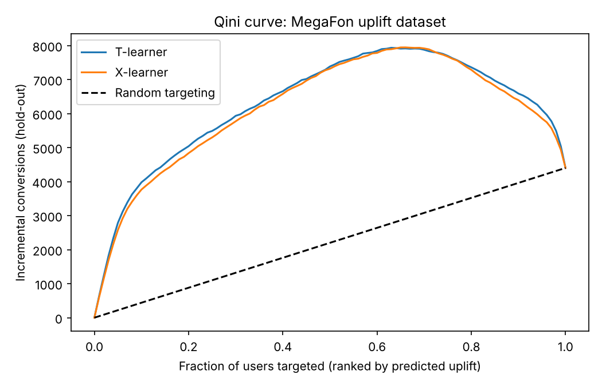

# abkit

A small toolkit for analysing A/B tests, run on two public experiments: the Hillstrom e-mail test (64k customers) and the MegaFon uplift dataset (600k users).

It covers the checks I'd want before trusting a test result: sample ratio mismatch, multiple-testing correction, variance reduction (CUPED/CUPAC), ratio metrics via the delta method, sequential testing (mSPRT), and uplift models for targeting.

## Results

**Hillstrom**
- Randomisation looks fine: SRM p = 0.90.
- The Mens e-mail raised visit rate from 10.6% to 18.3% (Holm p < 1e-100) and spend per customer from $0.65 to $1.42 (p = 3.5e-7).
- Revenue per visit didn't change significantly ($6.15 → $7.78, 95% CI [-0.30, 3.57]). The e-mail brought more visits, not better ones.
- CUPED barely helped here (0.4% variance reduction on visits); last year's spend just isn't very predictive. CUPAC got 2.2%.
- No usable uplift signal (Qini CI includes 0).

**Peeking** (2,000 simulated A/A tests, 20 looks each)

| | False positive rate |
| --- | --- |
| Look once at the end | 5.6% |
| Stop at the first p < 0.05 | 26.2% |
| mSPRT | 1.8% |

**MegaFon uplift**
- T-learner Qini 0.0222 (95% CI 0.0216–0.0228).
- On held-out users, the top 30% by predicted uplift gained +22.0 pts conversion from treatment; the other 70% lost 2.4 pts. Treating only the top 30% captures 135% of the total gain.



## Layout

```
abkit/stats.py        SRM, z-test, CUPED, delta method, Holm, sample size
abkit/sequential.py   peeking vs mSPRT, simulator
abkit/uplift.py       T/X-learner, Qini
sql/                  DuckDB queries for the scorecard and segment cuts
scripts/              the analyses; write to reports/
```

## Run it

```bash
pip install -r requirements.txt
make data
make analysis
make test
```

## Notes

- Holm correction covers all six primary tests (2 arms × 3 metrics).
- CUPAC predictions are 5-fold cross-fitted, so no row's covariate has seen its own outcome.
- mSPRT has less power than a fixed-horizon test at the same sample size. That's the cost of being allowed to stop early.
